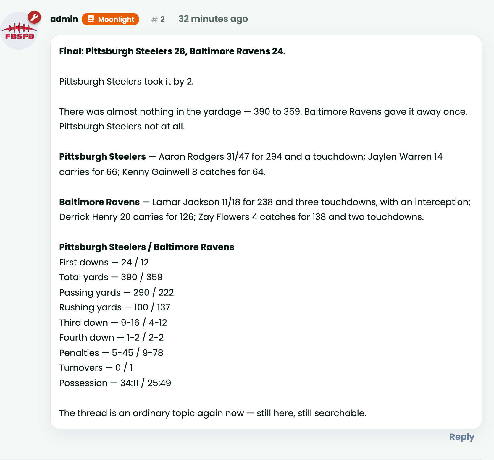
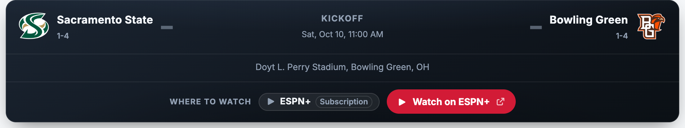
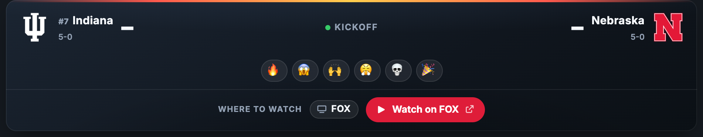
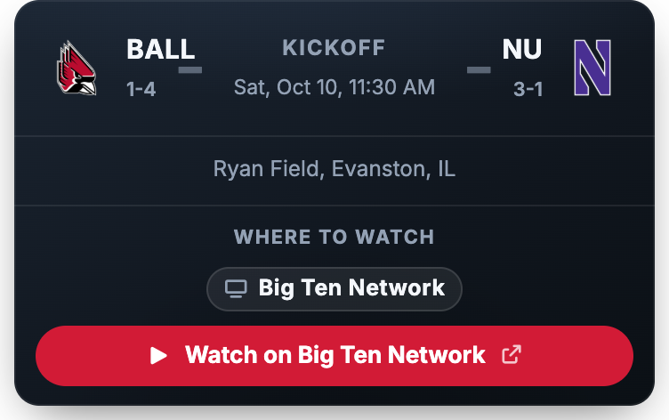
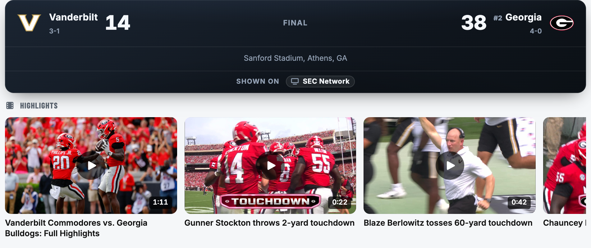
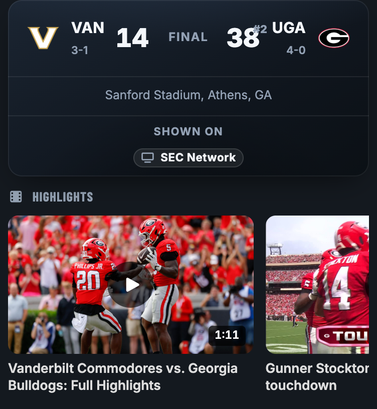
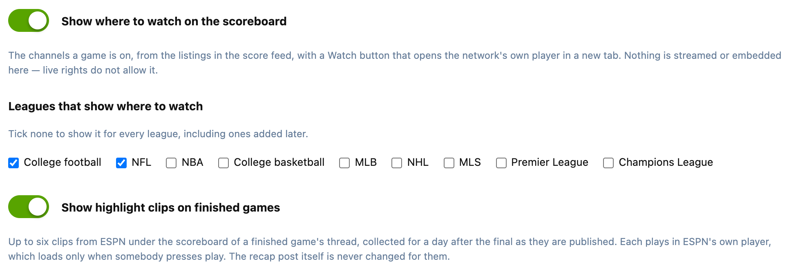
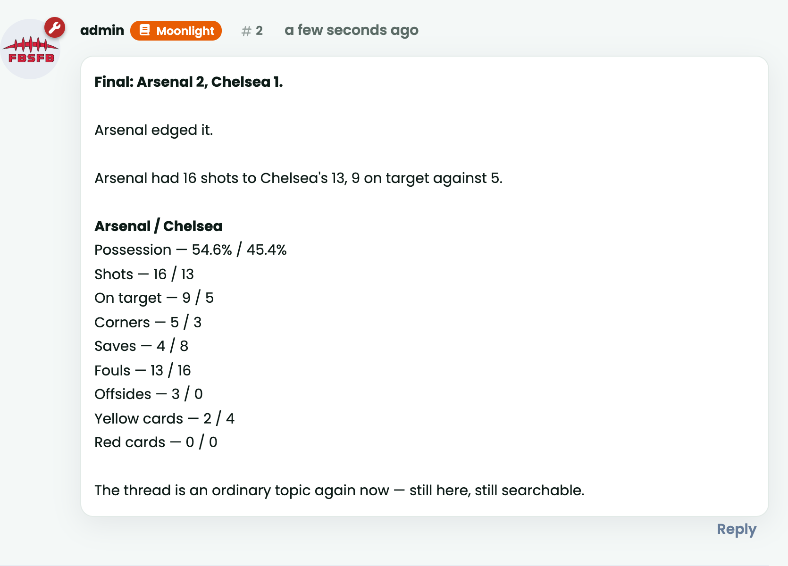

# Game Day

A thread for every game, opened before kickoff and finished with a recap that
says how the game was won.

Game Day reads the fixtures and box scores that
[Picks](https://github.com/ernestdefoe/picks) already syncs from
CollegeFootballData. It calls no provider itself — Picks owns the provider, the
API key and the call budget, and one place is what makes a budget enforceable.
The one thing it does is ask Picks for fresh live scores while a game is on;
see [Live scores](#live-scores).

## What it does

**Opens a thread before kickoff.** An ordinary discussion, in the home team's
tag, three hours out by default. Ordinary is the point: it is quotable,
searchable, moderatable, and still there if this extension is removed.

**Says the game is on.** Flarum has no live state for a discussion, so this does
not pretend to have ported one — it sticks the thread while the game is being
played and unsticks it afterwards, which says the same thing in a way readers
already understand. Needs `flarum/sticky`; without it the setting says so.

**Finishes it with a recap that is worth reading.** A real one, written from a
real box score:



The recap is posted the moment a game settles and rewritten in place when the
box score arrives — the provider publishes statistics minutes to hours after the
final whistle, and waiting would delay the one thing everybody in the thread is
waiting for. A game the provider never covered simply keeps the score.

## Live scores

While a game is being played, the scoreboard is fresher than Flarum's
scheduler alone could make it. `schedule:run` fires once a minute, which is fine
for a final score and visibly late for a game clock.

So when a scoreboard is asked for — the board in a game thread
(`GET /api/gameday/board/{id}`) or the current-games widget
(`GET /api/gameday/board`) — Game Day first asks Picks to pull the live ESPN
scores (`SyncScoresService::syncFromEspn()`), then answers with the new numbers.
It is kept cheap and polite:

- **Only while a game is on.** If no Picks game is `in_progress`, nothing is
  fetched; that check is one indexed query.
- **At most once every 8 seconds, for the whole forum.** The fetch is guarded
  by an atomic cache lock, so a thread with four hundred readers makes the same
  number of calls to ESPN as one with a single reader.
- **Never at the board's expense.** A feed that is down, or a Picks without that
  service, just means the board shows the last scores Picks synced.

There is no setting for it: it is part of drawing the board. The calls are made
by Picks' own code, with Picks' own feed, and Game Day still talks to no
provider directly.

## Where to watch

The scoreboard at the head of every game thread says where the game is on, and
gets people there in one tap:



Each channel is a chip — TV, streaming or radio, national listings first and
local ones labelled with their team's area — and the **Watch** button opens that
network's own live page in a new tab: ESPN's watch page (or the game itself in
ESPN's player, when the feed carries that link), FOX Sports for FOX, FS1 and the
Big Ten Network, CBS Sports for CBS and CBS Sports Network, Peacock for NBC, and
so on. Services that are nothing but a subscription — ESPN+, Peacock, Prime
Video — are marked as one. Nothing here says a game is free.



No video is embedded. Live rights are sold per market and wrapped in DRM, and a
forum cannot carry a broadcast; it can say where one is. The listings come from
the scoreboard payload Picks already fetches, so drawing them costs no request.
After the final whistle the row shrinks to a record of where it was shown, and a
game with no listing shows nothing at all. On a phone the chips wrap and the
button takes its own line:



The scoreboard widget shows the chips on each card, and the button only when it
is showing a single game.

## Highlights

Once a game is final, the clips ESPN publishes for it appear under the
scoreboard — the full-game package first, then the plays in order, up to six:



Each clip is a thumbnail until somebody presses play, and only then becomes
ESPN's own syndicated player, so a thread does not load six video players
before anyone has chosen one. Clips arrive minutes to hours after the final, so
the hourly pass keeps looking for a day after the game, at most every 45
minutes per thread. They are drawn by the thread itself and never written into
the recap post: post text is parsed, and a feed's markup does not belong in it.



Both are on by default. **Admin → Game Day** turns either off, and limits where
to watch to particular leagues:



## More than one sport

The recap's *structure* is fixed — a score, a result, a sentence on how it went,
the players worth naming, a comparison — and its *words* come from the sport.

Here is the same code on a Premier League match, from the same afternoon:



American football talks about yards, turnovers and a quarterback's line. Soccer
talks about shots, possession and yellow cards, treats a draw as an ordinary
result rather than a curiosity, and names no players at all, because ESPN's
match summary carries no player breakdown to name one from. Basketball, baseball
and ice hockey each have their own words and their own thresholds — three points
is a rout in football and a coin toss in basketball.

Which sport a game is described in comes from **its season's league** in Picks,
so a board following the NFL and the Premier League gets both right on the same
Sunday. **Admin → Game Day → Sport** is the fallback, for a season created
before leagues existed.

Adding a league is a class implementing `Service\Sports\Sport` and one line in
`Service\Sports\Sports` — an extension can register its own without editing a
file it does not own, and the admin dropdown picks it up from the server rather
than from a second list in the JavaScript.

Everything below the score is earned. A yardage line is only printed when the
two are far enough apart to mean something; a turnover line only when somebody
actually lost the ball; a comparison line only when at least one side has the
figure. A recap that always has three sentences has three sentences of nothing
on the day nothing happened.

## Installing

```sh
composer require ernestdefoe/gameday
php flarum migrate
php flarum cache:clear
```

Then in **Admin → Game Day**: switch it on, set the member the threads are
posted as, and map each team to a tag. Nothing is posted until it is on, and
there is no default author on purpose — posting as whoever happens to be user 1
puts a founder's name on a hundred threads they did not write.

Two commands run on Flarum's scheduler and need nothing else:

- `gameday:tick` — every minute; opens, starts and resolves threads.
- `gameday:enrich` — hourly; fills out recaps whose box score has since
  arrived, looks for highlight clips, and refreshes the opening post of every
  game that has not kicked off yet, so a kickoff time that moved is corrected
  (up to 100 a run). An opener is only rewritten while it is still Game Day's
  own: the first post, by the account Game Day posts as, still ending with its
  usual closing line, and only if the text would actually change. A post
  someone has rewritten past that is left alone.

## Requires

- Flarum 2
- [`ernestdefoe/picks`](https://github.com/ernestdefoe/picks) for the fixtures
  and box scores — a Picks with the `broadcasts` and `highlights` columns for
  the full channel listing and the clips; an older one still gives the national
  channel, and no clips
- `flarum/tags` (optional — threads are posted untagged without it)
- `flarum/sticky` (optional — the game-is-on state does nothing without it)

## Tests

The recap is a pure function of a game and its box score, so it is tested
without a database, a network or Flarum:

```sh
php tests/run.php
```

The box score is CollegeFootballData's real answer for that Notre Dame game,
normalised by Picks' own code rather than typed by hand. The same assertions run
on the Convoro build of Game Day, which is how the two are kept saying the same
things.

## Support

- **Support forum:** [Game Day on ernestdefoe.online](https://ernestdefoe.online/d/113)
- **Bug reports:** [GitHub issues](https://github.com/ernestdefoe/gameday/issues)

## Licence

MIT.
